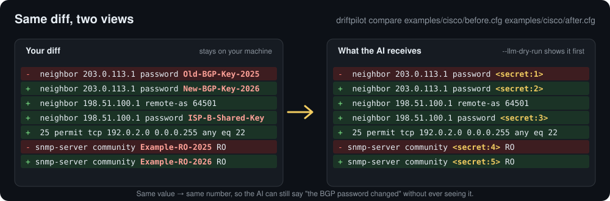

# DriftPilot

[](https://github.com/yusaku-umemoto/DriftPilot/releases/latest)
[](LICENSE)


**Cisco・FortiGate・Si-R の config を意味で比べ、パスワードを見せずに AI に変更を説明させるツールです。**

[English](README.md) · [手引き](docs/guide/ja/README.md) · [ダウンロード](https://github.com/yusaku-umemoto/DriftPilot/releases/latest)



ネットワーク機器の config と show コマンドの出力を比べ、意味のある差分だけを取り出します。望めば、その差分の意味を AI に答えさせます。パスワード・鍵・SNMP のコミュニティ名は、手元を出る**前に** `<secret:N>` に置き換え、送る文の全体を先に見せます。

## なぜ DriftPilot か

- **ふつうの diff は雑音が多い:** 行の並べ替えやブロックの移動に、大事な ACL の 1 行が埋もれます。DriftPilot は config を読んで意味で比べ（構造化比較）、読めない部分は行の比較で補います
- **config をチャットに貼ると秘密が漏れる:** 送るのは差分だけです。公開している表で秘密を伏せ、安全に伏せられない行は送らず、毎回承認を求めます
- **通信しないで使える:** AI と更新の確かめを使わなければ、どこにも通信しません。AI は自分の API キー（OpenAI 互換・Anthropic）か手元の CLI で使います

## 2 分で試す

### 配布版で（Python は要りません）

1. [Releases](https://github.com/yusaku-umemoto/DriftPilot/releases/latest) から使う OS の分を取って開きます（初めて開くときの警告は「[入れる](#入れる)」を見てください）
2. 例の config を取ります: [`examples/cisco/before.cfg`](examples/cisco/before.cfg) と [`examples/cisco/after.cfg`](examples/cisco/after.cfg)
3. 2 つのファイルを DriftPilot の窓に落とします。比較が自動で始まります

上りのインターフェース・BGP のネイバー・ACL の行が増え、SNMP のコミュニティ名が変わったことが分かります。AI も通信も使いません。

### コマンドで

```bash
git clone https://github.com/yusaku-umemoto/DriftPilot.git
cd DriftPilot
python3.14 -m venv .venv
.venv/bin/python -m pip install -e .
.venv/bin/driftpilot compare examples/cisco/before.cfg examples/cisco/after.cfg
```

続けて、AI に送る文をそのまま見ます。送信はせず、API キーも要りません:

```bash
.venv/bin/driftpilot compare examples/cisco/before.cfg examples/cisco/after.cfg --mode raw --llm-dry-run
```

その中の変わった行:

```text
-    24   neighbor 203.0.113.1 password <secret:1>
+    29   neighbor 203.0.113.1 password <secret:2>
+    31   neighbor 198.51.100.1 remote-as 64501
+    32   neighbor 198.51.100.1 password <secret:3>
+    33   neighbor 198.51.100.1 description ISP-B
+    38   25 permit tcp 192.0.2.0 0.0.0.255 any eq 22
-    32  snmp-server community <secret:4> RO
+    41  snmp-server community <secret:5> RO
```

FortiGate と Si-R の例と、短い試し方は [`examples/`](examples/README.md) にあります。

## できること

- **config の比較:** Cisco 系（IOS・IOS-XE などの字下げの config）・FortiGate・富士通 Si-R の config を、行の並びではなく意味で比べます（構造化比較）。読めない部分は行の比較（単純比較）で補います
- **show の比較:** show コマンドの出力を、表として読める範囲で比べます
- **複数のコマンドが入ったログ:** 1 つのファイルに config と show がまとめて入っていても、コマンドごとに分けて比べます
- **一括比較:** 変更前と変更後のフォルダーを選ぶと、ファイル名や hostname で組にして、まとめて比べます
- **AI での解析（任意）:** 差分の要点と影響を AI に答えさせます。OpenAI 互換・Anthropic などの API、手元の CLI を使えます
- **出力:** 結果を JSON・HTML・CSV で保存できます

## 秘密を守るしくみ

- AI に送るのは差分だけです。config の全文は、選んだときだけ送ります
- パスワード・鍵・コミュニティ名などは、送る前に伏せます（`<secret:N>`）。同じ値は同じ番号になるので、AI は「パスワードが変わった」と言えます。伏せられない形の行は送りません
- 送る前に、送る文の全体を見せて承認を求めます
- AI と更新の確かめを使わなければ、どこにも通信しません

伏せる処理のコードは `src/driftpilot/llm_analyzer/` にあります。誰でも確かめられます。`driftpilot mask-patterns` で伏せる表の全体を出せます。

## 入れる

### 配布版（Python は要りません）

[Releases](https://github.com/yusaku-umemoto/DriftPilot/releases/latest) から、使う OS の分を取ってください。

| OS | ファイル | メモ |
|---|---|---|
| Windows 10 / 11（x64） | `DriftPilot-<版>-windows-x64.zip` | 展開して `DriftPilot.exe` を開きます。Windows 10 では WebView2 Runtime が要ることがあります |
| macOS（Apple シリコン） | `DriftPilot-<版>-macos-arm64.dmg` | `DriftPilot.app` を「アプリケーション」に入れて開きます |

署名をしていないので、初めて開くときに OS の警告が出ます。

- **Windows:** 「Windows によって PC が保護されました」→「詳細情報」→「実行」
- **Mac:** 「開発元を確認できない」→ システム設定の「プライバシーとセキュリティ」→「このまま開く」

Windows で「画面の表示部品を使えません」と出たら、zip の展開が途中で止まっています。PowerShell の `Expand-Archive` か 7-Zip で展開し直してください（[くわしく](docs/guide/ja/troubleshooting.md)）。

### ソースから

Python 3.14 が要ります。

```bash
git clone https://github.com/yusaku-umemoto/DriftPilot.git
cd DriftPilot
python3.14 -m venv .venv
.venv/bin/python -m pip install -e ".[gui,llm]"
.venv/bin/driftpilot gui
```

Windows では `.venv\Scripts\python.exe`・`.venv\Scripts\driftpilot.exe` に読み替えてください。`gui` は画面、`llm` は AI での解析のための追加です。コマンドでの比較は、これらが無くても動きます。

コマンドで比べる例:

```bash
driftpilot compare before.cfg after.cfg
driftpilot compare before.cfg after.cfg --format json --save result.json
driftpilot batch --pair-by-name before_dir after_dir --confirm
```

`driftpilot --help` で全部のコマンドを見られます。くわしくは [コマンドの手引き](docs/guide/ja/cli.md) を見てください。

### 設定の置き場所

- **Windows:** 展開したフォルダーの `settings\`。フォルダーの外には置きません（API キーを除く）
- **Mac:** `~/Library/Application Support/DriftPilot/`
- **API キー:** Windows は資格情報マネージャー、Mac はキーチェーン。設定画面の「削除…」で消せます
- **画面の色:** 設定画面の「表示」タブで、システム設定に合わせる・白モード・黒モードから選べます
- **言語:** 設定画面の「表示」タブ（英語の画面では「Settings…」→「Display」）で、English・日本語・システム設定に合わせる から選べます。既定は英語です。日本語にするには「日本語」を選んで保存し、DriftPilot を開き直してください

### 新しい版の確かめ

- 設定画面の「更新」タブの「更新を確かめる」で、GitHub に新しい版が出ているかを確かめます
- 既定では、ボタンを押したときだけ確かめます
- 「起動したときに新しい版を確かめる（自動アップデートチェック）」をオンにして保存すると、起動のたびに確かめ、新しい版があれば比較の画面の上に知らせます
- 送るのは DriftPilot の版だけです（config・設定・API キーは送りません）
- Windows の zip 版と Mac のアプリは、新しい版があれば「更新する」で取ってきて、署名を確かめてから入れ替えます（DriftPilot が一度閉じて、新しい版が開きます）
- 0.1.0 には更新の機能がありません。0.1.0 から 0.2.0 へは、配る物に入っている `はじめにお読みください.txt` の「■ 更新するとき」の手順で、手で入れ替えてください

## 状態

0.2.3（試用版）です。画面と出力の形は、これから変わることがあります。不具合や、うまく読めない config の例は [Issues](https://github.com/yusaku-umemoto/DriftPilot/issues) へどうぞ。実在のアドレス・ホスト名・秘密は、例の値に置き換えてから貼ってください。

## ライセンス

[Apache License 2.0](LICENSE)。配布版に同梱している部品のライセンスは、配布版の中の `THIRD_PARTY_LICENSES.txt` にあります。
