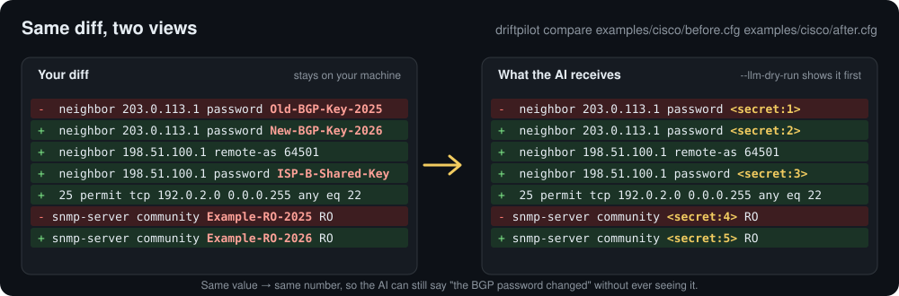

# DriftPilot

[](https://github.com/yusaku-umemoto/DriftPilot/releases/latest)
[](LICENSE)


**Diff Cisco, FortiGate and Fujitsu Si-R configs by meaning — and let AI explain the change without ever seeing your passwords.**

[日本語](README.ja.md) · [User guide](docs/guide/README.md) · [Download](https://github.com/yusaku-umemoto/DriftPilot/releases/latest)



DriftPilot compares two network device configs (or two `show` outputs), shows only the changes that matter, and — if you want — asks an AI model what those changes mean. Passwords, keys and SNMP communities are replaced with `<secret:N>` **before** anything leaves your machine, and you see the exact text first.

## Why DriftPilot

- **Plain `diff` is noisy.** Reordered lines, moved blocks and cosmetic changes bury the one ACL entry that matters. DriftPilot parses the config and compares it by meaning (structured compare), and falls back to a line diff for anything it cannot parse.
- **Pasting configs into a chatbot leaks secrets.** DriftPilot sends only the differences, masks secrets with a published rule table, refuses to send lines it cannot mask safely, and asks for your approval every time.
- **It works offline.** Without AI analysis and update checks, DriftPilot makes no network connections. Bring your own API key (OpenAI-compatible or Anthropic) or a local CLI.

## Try it in 2 minutes

### With the app (no Python needed)

1. Download the file for your OS from [Releases](https://github.com/yusaku-umemoto/DriftPilot/releases/latest) and open it (see [Install](#install) for the first-launch warning).
2. Download the sample configs: [`examples/cisco/before.cfg`](examples/cisco/before.cfg) and [`examples/cisco/after.cfg`](examples/cisco/after.cfg).
3. Drop both files onto the DriftPilot window. The comparison starts automatically.

You will see a new uplink interface, a new BGP neighbor, a new ACL entry and a changed SNMP community — with no AI and no network involved.

### From the command line

```bash
git clone https://github.com/yusaku-umemoto/DriftPilot.git
cd DriftPilot
python3.14 -m venv .venv
.venv/bin/python -m pip install -e .
.venv/bin/driftpilot compare examples/cisco/before.cfg examples/cisco/after.cfg
```

Then preview exactly what would be sent to an AI model. Nothing is sent and no API key is needed:

```bash
.venv/bin/driftpilot compare examples/cisco/before.cfg examples/cisco/after.cfg --mode raw --llm-dry-run
```

The changed lines in that preview:

```text
-    24   neighbor 203.0.113.1 password <secret:1>
+    29   neighbor 203.0.113.1 password <secret:2>
+    31   neighbor 198.51.100.1 remote-as 64501
+    32   neighbor 198.51.100.1 password <secret:3>
+    33   neighbor 198.51.100.1 description ISP-B
+    38   25 permit tcp 192.0.2.0 0.0.0.255 any eq 22
-    32  snmp-server community <secret:4> RO
+    41  snmp-server community <secret:5> RO
```

FortiGate and Si-R samples are in [`examples/`](examples/README.md), with a short walkthrough.

## Features

- **Config comparison:** Compares Cisco-style configs (indented configs such as IOS and IOS-XE), FortiGate and Fujitsu Si-R configs by meaning rather than by line order (structured comparison). Parts it cannot parse are compared line by line (raw comparison).
- **show comparison:** Compares `show` command output as tables where possible.
- **Logs with many commands:** If one file contains several configs and `show` outputs, they are split by command and compared one by one.
- **Batch comparison:** Pick a "before" folder and an "after" folder; files are paired by file name or hostname and compared together.
- **AI analysis (optional):** Ask an AI model for the key points and impact of the differences. Works with OpenAI-compatible and Anthropic APIs, and with local CLIs.
- **Output:** Save results as JSON, HTML or CSV.

## How secrets are protected

- Only the differences are sent to the AI. The full config is sent only when you choose to.
- Passwords, keys, SNMP communities and similar values are masked before sending (`<secret:N>`). The same value gets the same number, so the AI can still say "the password changed". Lines whose secrets cannot be masked are not sent.
- The full text to be sent is shown for your approval before anything is sent.
- Without AI and update checks, DriftPilot makes no network connections.

The masking code lives in `src/driftpilot/llm_analyzer/`, so anyone can review it. Run `driftpilot mask-patterns` to print the full rule table.

## Install

### Prebuilt apps (no Python needed)

Download the file for your OS from [Releases](https://github.com/yusaku-umemoto/DriftPilot/releases/latest).

| OS | File | Notes |
|---|---|---|
| Windows 10 / 11 (x64) | `DriftPilot-<version>-windows-x64.zip` | Extract and open `DriftPilot.exe`. Windows 10 may need the WebView2 Runtime. |
| macOS (Apple silicon) | `DriftPilot-<version>-macos-arm64.dmg` | Move `DriftPilot.app` to Applications and open it. |

The apps are not code-signed, so your OS will warn you the first time:

- **Windows:** "Windows protected your PC" → "More info" → "Run anyway"
- **macOS:** "cannot verify the developer" → System Settings → Privacy & Security → "Open Anyway"

If Windows shows "Cannot use the display component", the zip was not fully extracted. Extract it again with PowerShell `Expand-Archive` or 7-Zip ([details](docs/guide/troubleshooting.md#cannot-use-the-display-component-appears-on-windows)).

### From source

Requires Python 3.14.

```bash
git clone https://github.com/yusaku-umemoto/DriftPilot.git
cd DriftPilot
python3.14 -m venv .venv
.venv/bin/python -m pip install -e ".[gui,llm]"
.venv/bin/driftpilot gui
```

On Windows, use `.venv\Scripts\python.exe` and `.venv\Scripts\driftpilot.exe`. The `gui` extra adds the app window and the `llm` extra adds AI analysis; the command line works without them.

Command-line examples:

```bash
driftpilot compare before.cfg after.cfg
driftpilot compare before.cfg after.cfg --format json --save result.json
driftpilot batch --pair-by-name before_dir after_dir --confirm
```

Run `driftpilot --help` to see all commands, or read the [command-line guide](docs/guide/cli.md).

### Where settings are stored

- **Windows:** the `settings\` folder next to `DriftPilot.exe`. Nothing is written outside the extracted folder (except the API key).
- **macOS:** `~/Library/Application Support/DriftPilot/`
- **API keys:** Windows Credential Manager or the macOS Keychain. You can delete them with "Delete…" (「削除…」 in the Japanese screen) in the settings window.
- **Screen color:** on the "Display" (「表示」) tab of the settings window, choose "Match system settings", "Light mode" or "Dark mode".
- **Language:** on the "Display" tab of the settings window ("Settings…" → "Display"), choose English, 日本語 (Japanese) or "Match system setting". The default is English. To use Japanese, choose "日本語", save, and reopen DriftPilot.

### Checking for new versions

- "Check for updates" (「更新を確かめる」) on the "Update" (「更新」) tab of the settings window checks GitHub for a newer release.
- By default, DriftPilot checks only when you press that button.
- If you turn on "Check for a new version at startup (automatic update check)" (「起動したときに新しい版を確かめる（自動アップデートチェック）」) and save, DriftPilot checks at every start and shows a notice above the compare window when a newer version is available.
- The only thing sent is the DriftPilot version (no configs, settings or API keys).
- The Windows zip and the macOS app can download a newer version with "Update" (「更新する」), verify its signature, and replace themselves (DriftPilot closes once and the new version opens).
- Version 0.1.0 has no update feature. To go from 0.1.0 to 0.2.0, replace it by hand as described under "■ 更新するとき" (Updating) in `はじめにお読みください.txt` (Read me first), which comes with the download.

## Status

Version 0.2.3 (preview). The UI and output formats may still change. Bug reports and sample configs that DriftPilot reads badly are welcome in [Issues](https://github.com/yusaku-umemoto/DriftPilot/issues) — please replace real addresses, hostnames and secrets with example values first.

## License

[Apache License 2.0](LICENSE). Licenses of third-party components bundled in the prebuilt apps are listed in `THIRD_PARTY_LICENSES.txt` inside each distribution.
