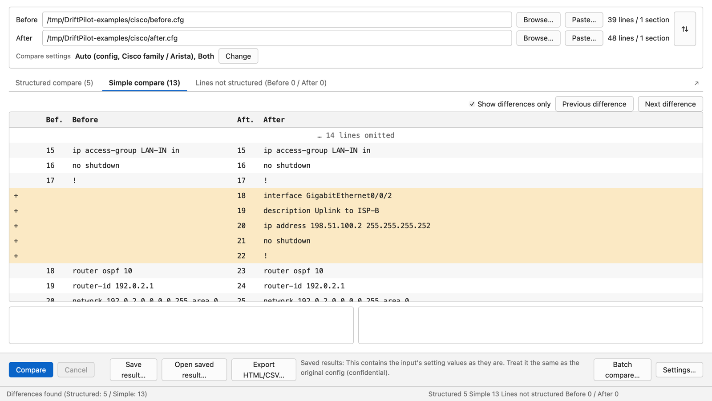
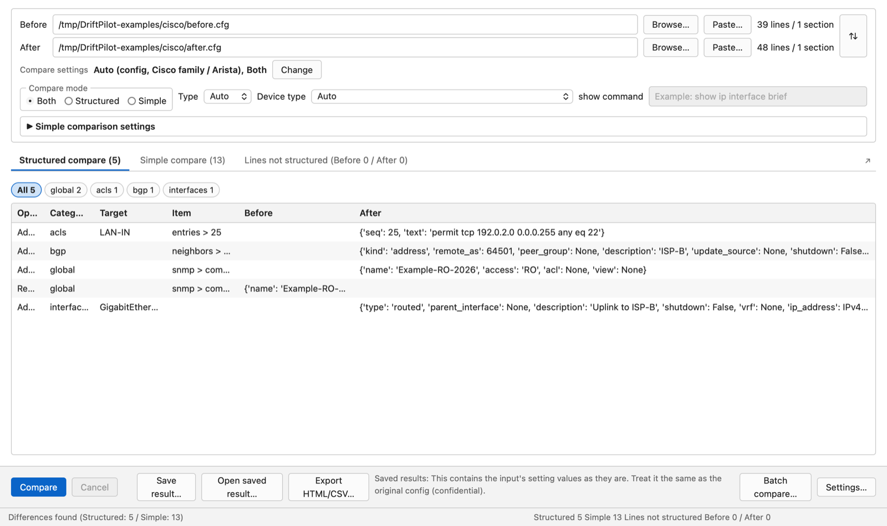
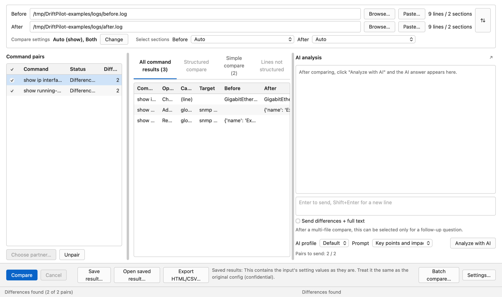
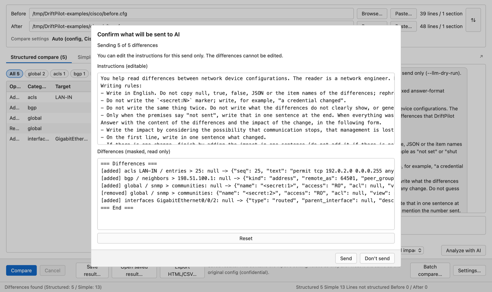
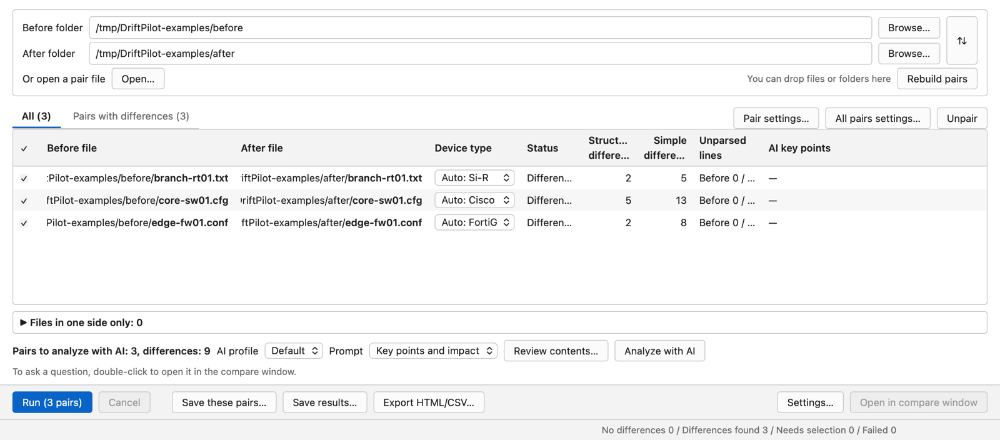
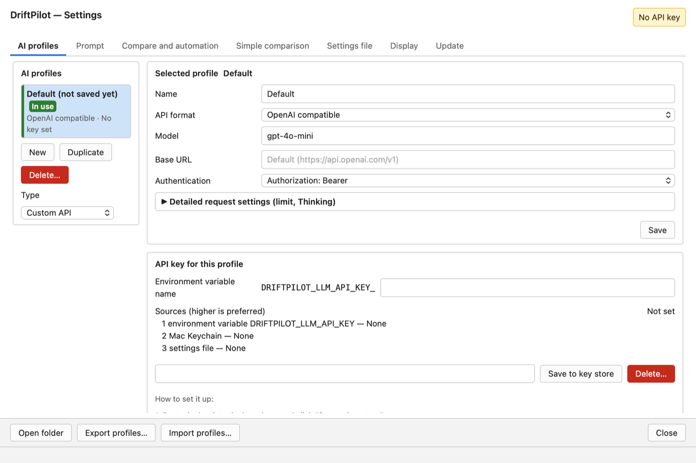
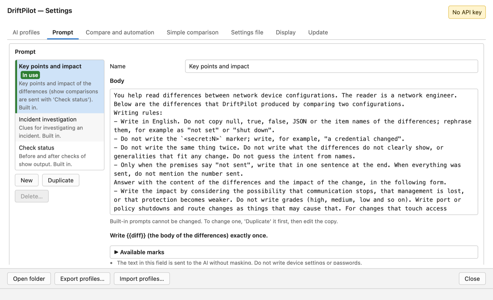
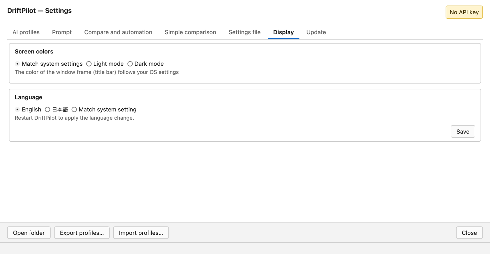
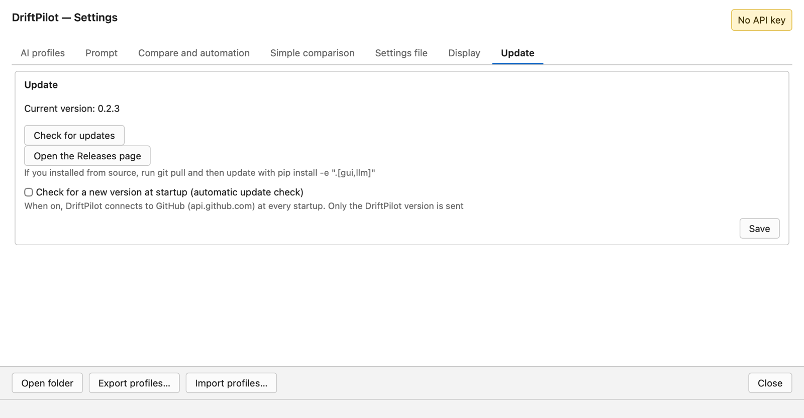

# Using the app (GUI)

[Back to the guide](README.md)

The screenshots on this page were taken on a Mac with version 0.2.3 and the sample files in [`examples/`](../../examples/README.md). The Windows app looks the same inside the window.

- [Start the app](#start-the-app)
- [1. Compare two files](#1-compare-two-files)
- [2. Read the results](#2-read-the-results)
- [3. Change the compare settings](#3-change-the-compare-settings)
- [4. Terminal logs with several commands](#4-terminal-logs-with-several-commands)
- [5. AI analysis](#5-ai-analysis)
- [6. Batch compare](#6-batch-compare)
- [7. Save and export](#7-save-and-export)
- [8. Settings](#8-settings)
- [9. Update DriftPilot](#9-update-driftpilot)

## Start the app

- **Windows (zip):** first unblock the zip (right-click → **Properties** → **Unblock**, see [Download](../../README.md#download)), then extract it and open `DriftPilot.exe`. The first time, "Windows protected your PC" may appear: click **More info** → **Run anyway**.
- **Mac:** open `DriftPilot.app` from Applications. The first time, "cannot verify the developer" may appear: open **System Settings → Privacy & Security** and click **Open Anyway**.
- **From source:** `driftpilot gui`.

The app has three kinds of windows: the **compare window** (opens first), the **batch compare** window and the **settings** window. The AI area can also be moved to its own window.

## 1. Compare two files

1. Set **Before** and **After** at the top. There are three ways:
   - **Browse…** — choose a file (`.txt`, `.log`, `.cfg`, `.conf` or any other file).
   - **Paste…** — paste a config or a terminal log copied from your terminal.
   - **Drag and drop** — drop one or two files onto the window. When you drop two files, the older one (or the one named like `before` / `pre` / `old`) becomes **Before**.
2. The number of lines and sections of each file appears on the right (`39 lines / 1 section`). **⇅** swaps Before and After.
3. Click **Compare**. When both files are set, the comparison starts automatically (you can turn this off in **Settings… → Compare and automation**).
4. The result appears in the tabs below, and the status line at the bottom shows the counts, for example `Differences found (Structured: 5 / Simple: 13)`.

DriftPilot detects the device type from the content (Cisco family and Arista, FortiGate, Fujitsu Si-R) and shows it in **Compare settings**, for example `Auto (config, Cisco family / Arista), Both`.

Files are read in UTF-8, UTF-16 or Shift_JIS. Text copied in odd forms is restored before comparing (RTF, HTML `<pre>`, line numbers or the same prefix on every line, a common indent, FortiGate lines wrapped by the terminal), and a note tells you when this happened.

## 2. Read the results

The result has three tabs (four when the files contain several commands).

### Structured compare

Differences by meaning, one row per change:

| Column | Meaning |
|---|---|
| **Operation** | Added / Removed / Changed |
| **Category** | `interfaces`, `bgp`, `acls`, `global` (SNMP, NTP, logging …), `vendor_specific` and so on |
| **Target** | The interface, ACL or neighbor that changed (for example `GigabitEthernet0/0/2`, `LAN-IN`) |
| **Item** | The setting inside the target (for example `entries > 25`, `neighbors > 198.51.100.1`) |
| **Before** / **After** | The value before and after the change. An empty cell means "not set". |

- The chips above the table (**All 5**, **global 2**, **acls 1** …) filter by category.
- Select a row to see the full values under the table.

### Simple compare

The familiar side-by-side, line-by-line diff (see the first screenshot).

- **Show differences only** folds unchanged lines (`… 14 lines omitted`).
- **Previous difference** / **Next difference** jump between changes.
- Added lines are marked `+`, removed lines `-`. Select a row to see both lines in full in the boxes below the table, with the changed characters marked.
- Use this tab to check exact text, such as password lines, which the structured compare shows only as "configured".

### Lines not structured

Lines that the structured compare could not read, counted as `(Before 0 / After 0)`. They are still compared in the simple compare, so nothing is dropped silently. If many lines appear here, the device type may be wrong: check **Compare settings**.

## 3. Change the compare settings

Click **Change** next to **Compare settings** (see the screenshot above):

| Setting | Choices |
|---|---|
| **Compare mode** | **Both** (default) / **Structured** / **Simple** |
| **Type** | **Auto** (default) / config / show |
| **Device type** | **Auto** (default), Cisco family and Arista, FortiGate (`fortinet`), Fujitsu Si-R (`fujitsu_sir`). For `show` output, type the platform name (for example `cisco_ios`). |
| **show command** | For `show` output, the exact command (for example `show ip interface brief`). With a device type and a show command, the output is compared as a table. |
| **Simple comparison settings** | Ignore lines that match a regular expression, replace text before comparing, ignore spaces / blank lines / case, detect moved lines, and the diff algorithm. The defaults are in **Settings… → Simple comparison**. |

## 4. Terminal logs with several commands

When a file is a terminal log with several commands (for example a saved SSH session with `show ip interface brief` and `show running-config`), DriftPilot finds the device prompt (such as `edge-rtr-01#`) and splits the log into one section per command. The line count shows it: `9 lines / 2 sections`.

- **Command pairs** (left) lists each command that appears on both sides, with its status and number of differences. Commands are paired by name, in order.
- **All command results** shows every difference of every pair in one table, with the command in the first column. Select a pair on the left to see only that pair in the other tabs.
- **Select sections** (top) lets you compare just one section of each file instead (**Auto** compares all pairs).
- **Choose partner…** pairs a command with another section by hand (for example when the same command was typed twice, or `show run | section bgp` against `show run`). **Unpair** separates a pair. Only the changed pair is compared again.
- Sections that are error output from a mistyped command (`% Invalid input detected`, Si-R `<ERROR> … : Unknown command` and so on) are listed as **Error output (not compared)** and are not paired or sent to the AI.
- The checkboxes on the left choose which pairs are sent to the AI (**Select or clear all**); the count appears as **Pairs to send: 2 / 2**.
- A log that contains several devices can be split into one file per device with **Split by device and open in Batch compare…**. You choose the output folder; the batch window opens with the pairs, and the comparison starts when you click **Run**.

## 5. AI analysis

You need an AI profile first ([Settings → AI profiles](#ai-profiles)).

1. After comparing, choose an **AI profile** and a **Prompt** at the bottom of the AI area on the right.
2. Click **Analyze with AI**.
3. **Confirm what will be sent to AI** always appears first:

   - **Instructions (editable)** — the prompt. You can change it for this send only; **Reset** puts it back.
   - **Differences (masked, read only)** — exactly what will be sent. In the example, the SNMP community names became `<secret:1>` and `<secret:2>`.
   - The first line tells you how many differences are sent (`Sending 5 of 5 differences`).
   - Click **Send** or **Don't send**.
4. The answer appears in the AI area. Type a follow-up question in the box below it (Enter to send, Shift+Enter for a new line).

What DriftPilot does before sending:

- Values on lines with secret words (passwords, keys, community strings and so on) are replaced with `<secret:N>`. The same value gets the same number, so the AI can still say "the password changed".
- Lines it cannot mask safely (unknown secret formats, PEM blocks, lines with invisible characters) are not sent at all.
- IP addresses, host names, interface names and descriptions are not hidden.
- You can add your own words to mask in **Settings… → Settings file → Extra masked words**.

Built-in prompts: **Key points and impact** (default), **Incident investigation**, **Check status** (used for `show` output). You can write your own in **Settings… → Prompt**.

Other options:

- **Send differences + full text** also sends both files (masked). More kinds of secret may be involved, so it is off by default.
- **Send to the AI automatically after comparing** (Settings → Compare and automation) skips the confirmation. It is off by default.
- **↗** opens the AI area in a separate window, so the result can use the whole width.
- The number of differences sent is limited (100 per pair and 1,000 in total by default; Settings → Compare and automation).

## 6. Batch compare

Open it with **Batch compare…** in the compare window.

1. Choose a **Before folder** and an **After folder** with **Browse…** (or drop folders or files onto the window), or **Open…** a pair file (YAML) that you saved before. Files with exactly the same name are paired.
2. Each pair gets a row with its **Device type**, detected automatically for each file (`Auto: Si-R`, `Auto: Cisco`, `Auto: FortiGate`). You can change it per pair from the drop-down.
3. Files without a partner are listed under **Files in one side only**. Pair them by:
   - selecting two and clicking **Pair the 2 selected**, or dragging one onto the other,
   - **Suggest by hostname** (reads the `hostname` in each file), or
   - **Ask AI for suggestions…** (only file names are sent, after confirmation).
4. Uncheck pairs you do not want to compare. **Pair settings…** / **All pairs settings…** change the compare settings of one pair or of all pairs. **Unpair** separates a pair. **Rebuild pairs** pairs the folders again.
5. Click **Run (3 pairs)**. **Cancel** stops after the current pair.
6. The table shows each pair's **Status** and counts (**Structured differences**, **Simple differences**, **Unparsed lines**). The **Pairs with differences** tab shows only the pairs that changed. The status line shows the totals (`No differences 0 / Differences found 3 / Needs selection 0 / Failed 0`).
7. Double-click a pair (or select it and click **Open in compare window**) to look at it in detail and to ask the AI follow-up questions.

AI in the batch window:

- Choose the **AI profile** and **Prompt**, then **Review contents…** to see what would be sent for all pairs, or **Analyze with AI** to send after one confirmation list.
- The answer's key points appear in the **AI key points** column.

## 7. Save and export

| Button | What it does |
|---|---|
| **Save result…** | Saves the result as JSON. It contains the original config values (including secrets), so treat it like the configs. |
| **Open saved result…** | Shows a saved result (read only). Results saved by the command line (`--save`) open too. |
| **Export HTML/CSV…** | Writes an HTML report or CSV. Secret lines are always masked in these files. |
| **Save these pairs…** (batch) | Saves the pairs as a pair file (YAML) that you can open again or run with `driftpilot batch`. |
| **Save results…** (batch) | Saves the results of all pairs (JSON Lines). |

Files are never overwritten.

## 8. Settings

Open with **Settings…**. The badge at the top right tells you whether AI analysis is ready (for example **No API key** or **AI analysis is available**).

### AI profiles

Where AI requests are sent. You can keep several profiles (for example one for a cloud service and one for a local AI) and switch between them.

1. **New** (or select **Default**) and choose a **Type**: OpenAI, Azure OpenAI, Claude, Qwen, DeepSeek, local AI, Codex CLI, Claude Code CLI, custom API and others. The **API format**, **Base URL** and **Authentication** are filled in for the type.
2. Enter the **Model** (for example `gpt-4o-mini`) and change the **Base URL** if needed.
3. Click **Save**.
4. Under **API key for this profile**, paste the key and click **Save to key store** (Mac Keychain or Windows Credential Manager). **Sources (higher is preferred)** shows where the key is read from: the environment variable `DRIFTPILOT_LLM_API_KEY` (or `DRIFTPILOT_LLM_API_KEY_` + the name you enter in **Environment variable name**, for this profile only), the key store, or the settings file.
5. **AI connection test** sends one short fixed text to check the connection (a very small charge may apply).
6. **Use this profile** makes it the one in use (marked **In use**).

**Export profiles…** / **Import profiles…** move profiles between computers (API keys are not included). **Open folder** opens the settings folder.

### Prompt

- The built-in prompts (**Key points and impact**, **Incident investigation**, **Check status**) cannot be edited. Click **Duplicate** to make your own copy, then edit its text.
- Your prompt must contain `{{diff}}` (where the differences go) exactly once. **Available marks** lists the other marks.
- The **premise** text added to every request is also set here. The text in this tab is sent to the AI as it is (not masked), so do not write configs or passwords in it.

### Compare and automation

Automatic compare when both files are set, automatic sending to the AI after comparing (off by default), the character (Mirarin) in the window, and the limits on how many differences are sent (per pair and in total).

### Simple comparison

The defaults of the simple-compare options (ignore lines, replacements, spaces, blank lines, case, moved lines, algorithm). They apply to new comparisons in the app; the command line does not read them.

### Settings file

Extra masked words, creating the settings file (`config.toml`), and diagnostics (where each setting was read from).

### Display

- **Screen colors:** **Match system settings** / **Light mode** / **Dark mode**.
- **Language:** **English** / **日本語** / **Match system setting**. Click **Save** and restart DriftPilot to apply. The language also changes the command line and the AI's answers.

### Update

See [Update DriftPilot](#9-update-driftpilot).

### Where settings are stored

- **Windows (zip):** the `settings\` folder next to `DriftPilot.exe`. Nothing is written outside the extracted folder (except the API key in Credential Manager).
- **Mac:** `~/Library/Application Support/DriftPilot/`.
- **API keys:** Windows Credential Manager or the Mac Keychain. **Delete…** in the AI profiles tab removes them.

## 9. Update DriftPilot

**Settings… → Update → Check for updates.** If a new version exists, click **Update**: DriftPilot downloads it, checks its signature, closes, replaces itself and opens the new version. Your settings and API keys stay.

- **Open the Releases page** opens the download page on GitHub.
- **Check for a new version at startup** shows a notice when a new version is out. When it is on, DriftPilot connects to GitHub (`api.github.com`) at every startup and sends only its version number.
- If you installed from source, update with `git pull` and `pip install -e ".[gui,llm]"`.
