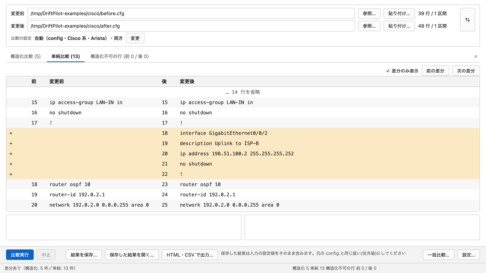
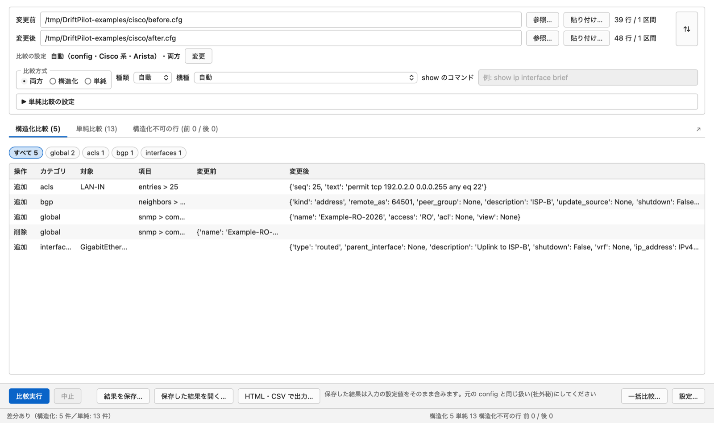
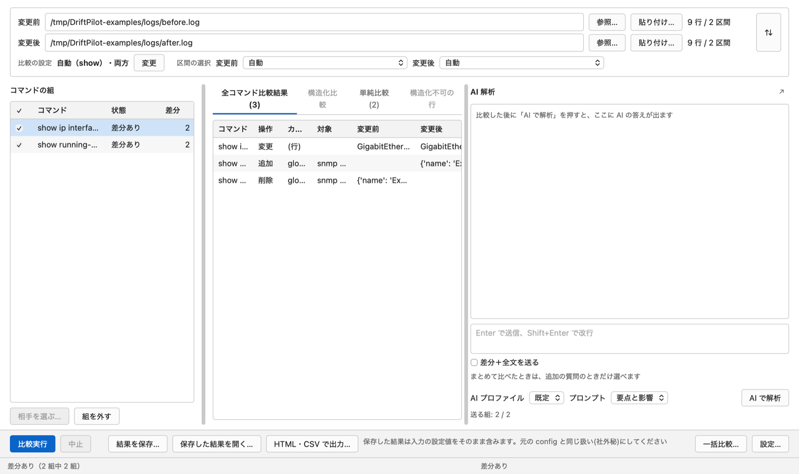
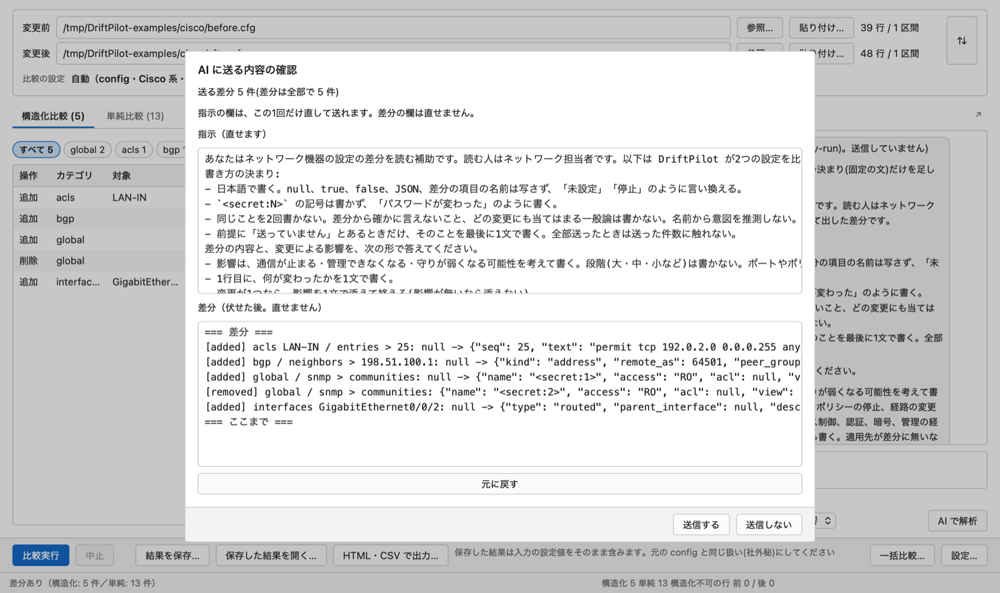
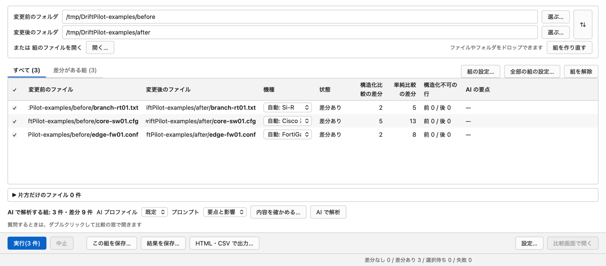
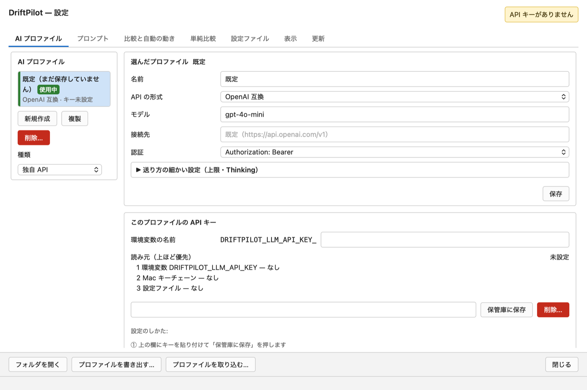
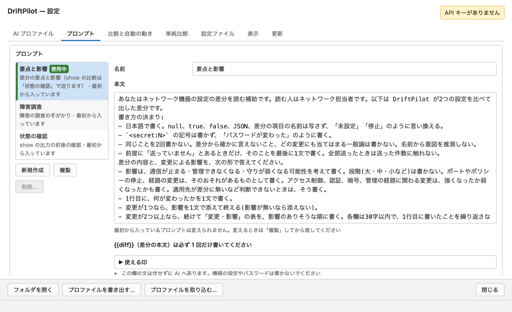
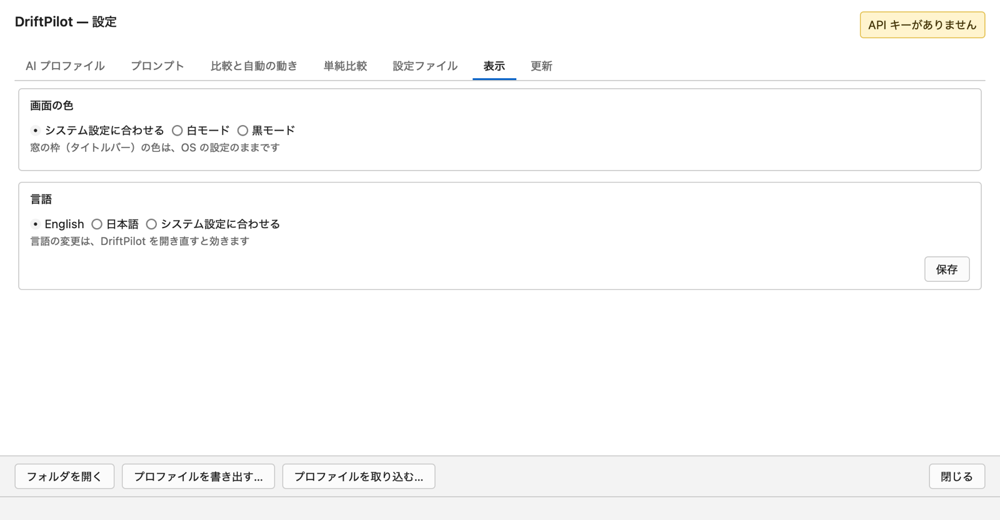
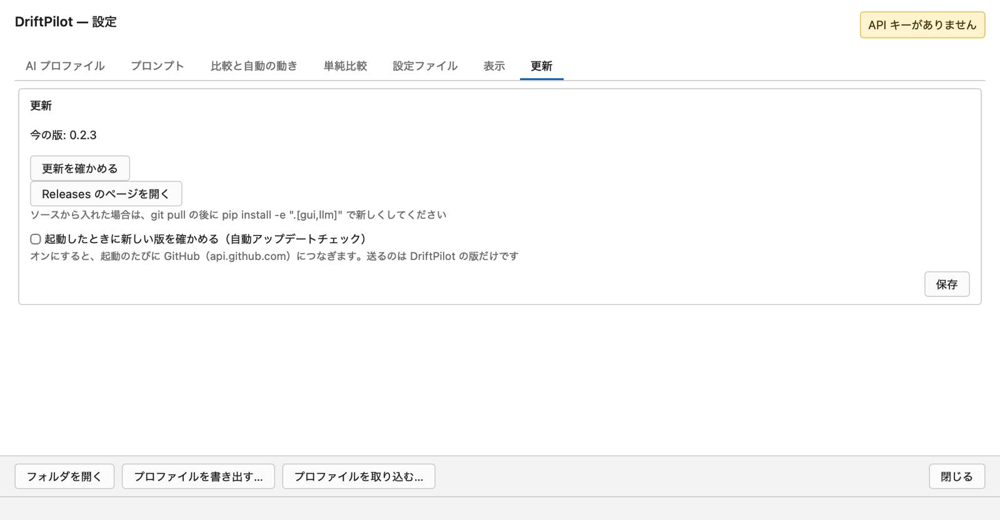

# 画面（GUI）の使い方

[手引きの目次へ](README.md)

このページの写真は、0.2.3 の Mac で [`examples/`](../../../examples/README.md) の例のファイルを使って撮ったものです。Windows でも窓の中は同じです。

- [開く](#開く)
- [1. 2 つのファイルを比べる](#1-2-つのファイルを比べる)
- [2. 結果の読み方](#2-結果の読み方)
- [3. 比較の設定を変える](#3-比較の設定を変える)
- [4. 複数のコマンドが入った端末のログ](#4-複数のコマンドが入った端末のログ)
- [5. AI での解析](#5-ai-での解析)
- [6. 一括比較](#6-一括比較)
- [7. 保存と書き出し](#7-保存と書き出し)
- [8. 設定](#8-設定)
- [9. DriftPilot を新しくする](#9-driftpilot-を新しくする)

## 開く

- **Windows（zip）:** 先に zip の「許可する」に✔を入れ（右クリック →「**プロパティ**」→「**許可する**」。「[ダウンロード方法](../../../README.ja.md#ダウンロード方法)」）、展開して `DriftPilot.exe` を開きます。初めて開くときに「Windows によって PC が保護されました」と出たら、「**詳細情報**」→「**実行**」を押します。
- **Mac:** 「アプリケーション」の `DriftPilot.app` を開きます。初めて開くときに「開発元を確認できない」と出たら、「**システム設定 → プライバシーとセキュリティ**」で「**このまま開く**」を押します。
- **ソースから:** `driftpilot gui`。

窓は 3 種類です。最初に開く**比較の窓**、**一括比較**の窓、**設定**の窓です。AI の欄は、別の窓に出すこともできます。

## 1. 2 つのファイルを比べる

1. 上の「**変更前**」と「**変更後**」にファイルを入れます。入れ方は 3 つです。
   - 「**参照…**」— ファイルを選びます（`.txt`・`.log`・`.cfg`・`.conf` など、どのファイルでも）
   - 「**貼り付け…**」— 端末から写した config やログを貼り付けます
   - **ドラッグ＆ドロップ** — ファイルを 1 つか 2 つ、窓に落とします。2 つ落とすと、古いほう（または `before`・`pre`・`old` のような名前のほう）が「変更前」になります
2. 右に、各ファイルの行数と区間の数が出ます（`39 行 / 1 区間`）。「**⇅**」で変更前と変更後を入れ替えます。
3. 「**比較実行**」を押します。2 つそろうと自動で比較を始めます（「設定… → 比較と自動の動き」で止められます）。
4. 結果が下のタブに出て、一番下の状態の行に数が出ます（例: `差分あり（構造化: 5 件／単純: 13 件）`）。

DriftPilot は中身から機種（Cisco 系と Arista・FortiGate・富士通 Si-R）を見分け、「**比較の設定**」に出します（例: `自動（config・Cisco 系・Arista）・両方`）。

ファイルは UTF-8・UTF-16・Shift_JIS で読みます。おかしな形で写した文字も、比べる前に戻します（RTF、HTML の `<pre>`、行番号や全行に同じ印が付いたもの、共通の字下げ、端末で折り返された FortiGate の行）。戻したときは注意で知らせます。

## 2. 結果の読み方

結果のタブは 3 つです（ファイルに複数のコマンドがあると 4 つ）。

### 構造化比較

意味で比べた差分です。1 行が 1 つの変更です。

| 列 | 意味 |
|---|---|
| **操作** | 追加・削除・変更 |
| **分類** | `interfaces`・`bgp`・`acls`・`global`（SNMP・NTP・ログなど）・`vendor_specific` など |
| **対象** | 変わったインターフェース・ACL・ネイバーなど（例: `GigabitEthernet0/0/2`・`LAN-IN`） |
| **項目** | 対象の中の設定（例: `entries > 25`・`neighbors > 198.51.100.1`） |
| **変更前**・**変更後** | 変わる前と後の値。空の欄は「未設定」です |

- 表の上の札（「**すべて 5**」「**global 2**」「**acls 1**」…）で、分類ごとに絞れます
- 行を選ぶと、表の下に値の全体が出ます

### 単純比較

おなじみの、左右に並べた行の差分です（最初の写真）。

- 「**差分のみ表示**」で、変わっていない行をたたみます（`… 14 行を省略`）
- 「**前の差分**」「**次の差分**」で変更の間を移ります
- 追加した行は `+`、削除した行は `-` です。行を選ぶと、表の下の枠に両方の行の全体が出て、変わった文字に印が付きます
- パスワードの行など、構造化比較では「設定あり」としか出ない文字を確かめるときに使います

### 構造化不可の行

構造化比較で読めなかった行です。`(前 0 / 後 0)` のように数が出ます。単純比較では比べているので、黙って捨てる行はありません。ここに多くの行が出るときは、機種が違うかもしれません。「比較の設定」を見てください。

## 3. 比較の設定を変える

「**比較の設定**」の横の「**変更**」を押します（上の写真）。

| 設定 | 選べるもの |
|---|---|
| **比較方式** | 「**両方**」（既定）・「**構造化**」・「**単純**」 |
| **種類** | 「**自動**」（既定）・config・show |
| **機種** | 「**自動**」（既定）・Cisco 系と Arista・FortiGate（`fortinet`）・富士通 Si-R（`fujitsu_sir`）。show の出力では、機種の名前（例: `cisco_ios`）を入れます |
| **show コマンド** | show の出力のとき、コマンドをそのまま入れます（例: `show ip interface brief`）。機種と show コマンドがそろうと、表として比べます |
| **単純比較の設定** | 正規表現に当たる行を無視する、比べる前に文字を置き換える、空白・空の行・大文字小文字を無視する、動いた行を見つける、差分の取り方。既定は「設定… → 単純比較」で決めます |

## 4. 複数のコマンドが入った端末のログ

ファイルが複数のコマンドの入った端末のログ（`show ip interface brief` と `show running-config` を打った SSH のやり取りを保存したものなど）のときは、機器のプロンプト（`edge-rtr-01#` など）を見つけて、コマンドごとの区間に分けます。行数の横に `9 行 / 2 区間` のように出ます。

- 左の「**コマンドの組**」に、両方にあるコマンドを、状態と差分の数とともに並べます。コマンドは名前で、出てきた順に組にします
- 「**全コマンド比較結果**」は、全部の組の差分を 1 つの表に出します（最初の列がコマンド）。左で組を選ぶと、ほかのタブにはその組だけが出ます
- 上の「**区間の選択**」で、各ファイルの 1 つの区間だけを比べることもできます（「自動」は全部の組を比べます）
- 「**相手を選ぶ…**」で、コマンドの相手を手で選び直せます（同じコマンドを 2 回打ったとき、`show run | section bgp` と `show run` を組にしたいときなど）。「**組を外す**」で組を外します。変わった組だけを比べ直します
- 打ち間違いのエラーの出力（`% Invalid input detected`、Si-R の `<ERROR> … : Unknown command` など）の区間は「**エラーの出力（比べていません）**」として並べ、組にも AI に送る組にも入れません
- 左のチェックで、AI に送る組を選びます（「**すべて選ぶ・すべて外す**」）。数は「**送る組: 2 / 2**」のように出ます
- 複数の機器が入ったログは、「**機器ごとに分けて一括比較で開く…**」で機器ごとのファイルに分けられます。書き出し先のフォルダーを選ぶと、一括比較の窓が組の入った状態で開き、「実行」を押すと比較が始まります

## 5. AI での解析

先に AI プロファイルが要ります（[設定 → AI プロファイル](#ai-プロファイル)）。

1. 比べた後、右の AI の欄の下で「**AI プロファイル**」と「**プロンプト**」を選びます。
2. 「**AI で解析**」を押します。
3. 送る前に、かならず「**AI に送る内容の確認**」が出ます。

   - 指示の部分は、この 1 回だけ直せます（元に戻すボタンもあります）
   - 差分の部分は、送る中身そのものです（直せません）。例では、SNMP のコミュニティ名が `<secret:1>`・`<secret:2>` に伏せられています
   - 一番上に、送る差分の数が出ます
   - 「**送る**」か「**送らない**」を押します
4. 答えが AI の欄に出ます。下の欄に続けて質問できます（Enter で送る、Shift+Enter で改行）。

送る前に DriftPilot がすること:

- 秘密の語（パスワード・鍵・コミュニティ名など）がある行の値を `<secret:N>` にします。同じ値は同じ番号になるので、AI は「パスワードが変わった」と言えます
- 安全に伏せられない行（知らない形の秘密、PEM の塊、見えない文字のある行）は送りません
- IP アドレス・ホスト名・インターフェース名・説明（description）は伏せません
- 伏せる語は「設定… → 設定ファイル → 伏せる語の追加」で足せます

最初から入っているプロンプト: 「**要点と影響**」（既定）・「**障害調査**」・「**状態の確認**」（show の出力のとき）。自分のプロンプトは「設定… → プロンプト」で作れます。

そのほか:

- 「**差分＋全文を送る**」は、両方のファイルの全体も（伏せて）送ります。いろいろな形の秘密が入りうるので、既定では切ってあります
- 「**比較の後に自動で AI に送る**」（設定 → 比較と自動の動き）は確認を飛ばします。既定では切ってあります
- 「**↗**」で AI の欄を別の窓にすると、結果を広く使えます
- 送る差分の数には上限があります（既定は 1 組 100 件・全部で 1,000 件。設定 → 比較と自動の動き）

## 6. 一括比較

比較の窓の「**一括比較…**」で開きます。

1. 「**変更前のフォルダ**」と「**変更後のフォルダ**」を「**選ぶ…**」で選びます（フォルダーやファイルを窓に落としてもかまいません）。前に保存した組のファイル（YAML）を「**開く…**」こともできます。名前がまったく同じファイルを組にします。
2. 組ごとに行ができ、「**機種**」はファイルごとに自動で見分けます（`自動: Si-R`・`自動: Cisco`・`自動: FortiGate`）。組ごとに選び直すこともできます。
3. 相手の無いファイルは「**片方だけのファイル**」に並びます。次のどれかで組にします。
   - 2 つ選んで「**選んだ 2 つを組にする**」を押す、または片方をもう片方に引きずって落とす
   - 「**hostname で候補を出す**」（各ファイルの `hostname` を読みます）
   - 「**AI に案を聞く…**」（確認の後、ファイル名だけを送ります）
4. 比べない組はチェックを外します。「**組の設定…**」「**全部の組の設定…**」で、1 つの組または全部の組の比較の設定を変えます。「**組を解除**」で組を外し、「**組を作り直す**」でフォルダーから組み直します。
5. 「**実行（3 件）**」を押します。「**中止**」は今の組が終わったところで止めます。
6. 表に、組ごとの「**状態**」と数（「**構造化比較の差分**」「**単純比較の差分**」「**構造化不可の行**」）が出ます。「**差分がある組**」のタブは、変わった組だけを出します。状態の行に合計が出ます（`差分なし 0 / 差分あり 3 / 選択待ち 0 / 失敗 0`）。
7. 組をダブルクリックする（または選んで「**比較画面で開く**」を押す）と、その組をくわしく見たり、AI に続けて質問したりできます。

一括比較の窓の AI:

- 「**AI プロファイル**」と「**プロンプト**」を選び、「**内容を確かめる…**」で全部の組の送る中身を見られます。「**AI で解析**」は、1 回の確認の一覧の後に送ります
- 答えの要点は「**AI の要点**」の列に出ます

## 7. 保存と書き出し

| ボタン | 働き |
|---|---|
| 「**結果を保存…**」 | 結果を JSON で保存します。元の config の値（秘密も）が入るので、config と同じように扱ってください |
| 「**保存した結果を開く…**」 | 保存した結果を見ます（読むだけ）。コマンドの `--save` で保存した結果も開けます |
| 「**HTML・CSV で出力…**」 | HTML の報告か CSV を書きます。秘密の行は必ず伏せます |
| 「**この組を保存…**」（一括比較） | 組を組のファイル（YAML）に保存します。もう一度開いたり、`driftpilot batch` で動かしたりできます |
| 「**結果を保存…**」（一括比較） | 全部の組の結果を保存します（JSON Lines） |

ファイルは上書きしません。

## 8. 設定

「**設定…**」で開きます。右上の札で、AI 解析を使えるかが分かります（例: 「**API キーがありません**」「**AI 解析を使えます**」）。

### AI プロファイル

AI の送り先です。クラウドのサービス用とローカルの AI 用のように、いくつも持って切り替えられます。

1. 「**新規作成**」（または「**既定**」を選ぶ）で、「**種類**」を選びます。OpenAI・Azure OpenAI・Claude・Qwen・DeepSeek・ローカル AI・Codex CLI・Claude Code CLI・独自 API などがあります。「**API の形式**」「**接続先**」「**認証**」は、種類に合わせて入ります。
2. 「**モデル**」（例: `gpt-4o-mini`）を入れ、要れば「**接続先**」を変えます。
3. 「**保存**」を押します。
4. 「**このプロファイルの API キー**」の欄にキーを貼り付けて、「**保管庫に保存**」を押します（Mac キーチェーンか Windows 資格情報マネージャー）。「**読み元（上ほど優先）**」に、キーをどこから読むかが出ます。環境変数 `DRIFTPILOT_LLM_API_KEY`（「環境変数の名前」に入れた名前を付けた `DRIFTPILOT_LLM_API_KEY_…` は、このプロファイルだけ）、保管庫、設定ファイルの順です。
5. 「**AI 接続テスト**」で、決まった短い文を 1 回送ってつながるか確かめます（ごくわずかな料金がかかることがあります）。
6. 「**このプロファイルを使う**」で使用中にします（「**使用中**」の印が付きます）。

「**プロファイルを書き出す…**」「**プロファイルを取り込む…**」で、別のパソコンにプロファイルを移せます（API キーは入りません）。「**フォルダを開く**」で設定のフォルダーを開きます。

### プロンプト

- 最初から入っているプロンプト（「要点と影響」「障害調査」「状態の確認」）は変えられません。「**複製**」して自分のものを作ってから直します
- 自分のプロンプトには、差分の入る印 `{{diff}}` を必ず 1 回だけ書きます。ほかの印は「**使える印**」にあります
- すべての問い合わせに付ける前提の文も、ここで決めます。このタブの文は伏せずに AI に送るので、機器の設定やパスワードは書かないでください

### 比較と自動の動き

2 つそろったときの自動の比較、比較の後に自動で AI に送るか（既定は切）、窓のキャラクター（ミラリン）、AI に送る差分の数の上限（1 組あたり・全体）です。

### 単純比較

単純比較のオプション（行の無視・置き換え・空白・空の行・大文字小文字・動いた行・差分の取り方）の既定です。画面での新しい比較に効きます。コマンドは読みません。

### 設定ファイル

伏せる語の追加、設定ファイル（`config.toml`）の作成、診断（各設定をどこから読んだか）です。

### 表示

- **画面の色:** 「**システム設定に合わせる**」・「**白モード**」・「**黒モード**」
- **言語:** 「**English**」・「**日本語**」・「**システム設定に合わせる**」。「**保存**」を押し、DriftPilot を開き直すと変わります。コマンドと AI の答えの言語も変わります

### 更新

「[DriftPilot を新しくする](#9-driftpilot-を新しくする)」を見てください。

### 設定の置き場所

- **Windows（zip）:** `DriftPilot.exe` の隣の `settings\` フォルダー。展開したフォルダーの外には書きません（資格情報マネージャーの API キーを除く）
- **Mac:** `~/Library/Application Support/DriftPilot/`
- **API キー:** Windows 資格情報マネージャーか Mac キーチェーン。AI プロファイルのタブの「**削除…**」で消せます

## 9. DriftPilot を新しくする

「**設定… → 更新 → 更新を確かめる**」を押します。新しい版があれば「**更新する**」を押すと、DriftPilot が取ってきて署名を確かめ、閉じて入れ替え、新しい版を開きます。設定と API キーはそのままです。

- 「**Releases のページを開く**」で、GitHub のダウンロードのページを開きます
- 「**起動したときに新しい版を確かめる**」を入れると、新しい版が出たときに知らせます。入れると、起動のたびに GitHub（`api.github.com`）につなぎ、DriftPilot の版の番号だけを送ります
- ソースから入れたときは、`git pull` の後に `pip install -e ".[gui,llm]"` で新しくします
